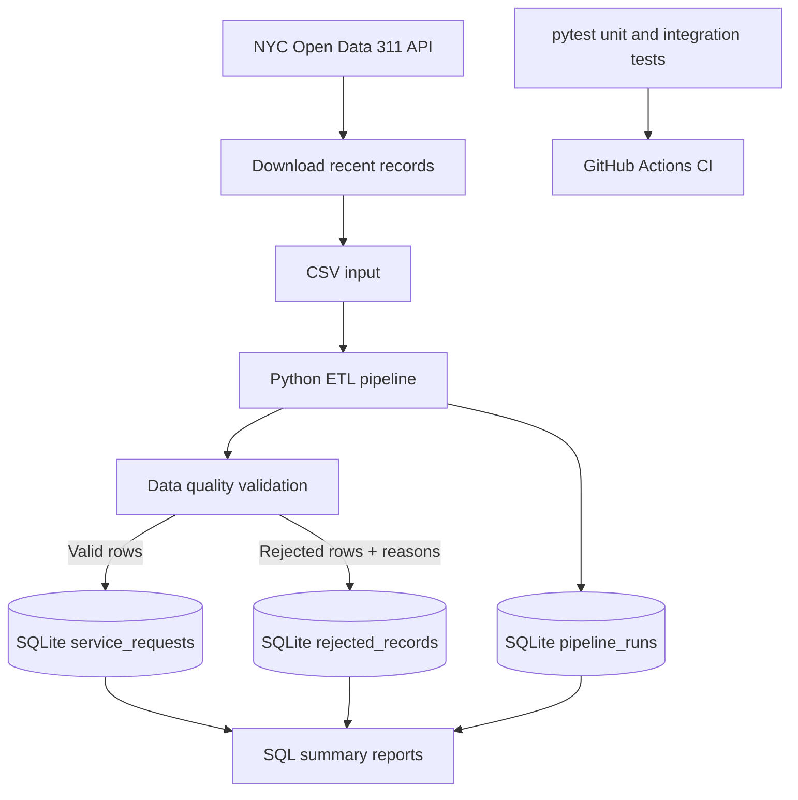

# TrustLayer — Data Quality & Pipeline Monitoring

[](https://github.com/shreyayp/trustlayer-nyc311-data-quality-pipeline/actions/workflows/ci.yml)


**TrustLayer is a beginner-friendly data engineering portfolio project focused exclusively on NYC 311 service requests.** It downloads a limited sample of current public records from NYC Open Data, validates data quality, stores accepted records in SQLite, quarantines rejected rows with reasons, records pipeline-run metrics, and tests changes automatically with GitHub Actions.

> The checked-in CSV is synthetic teaching data so the pipeline and tests work offline. For real current data, use the included NYC Open Data downloader. The project has one data domain only: NYC 311 service requests.

## 1. Problem statement

Public-service request data can contain missing identifiers, duplicate records, invalid timestamps, inconsistent fields, or records that cannot be trusted for reporting. TrustLayer demonstrates a repeatable way to catch those problems before records are used downstream.

## 2. Project objectives

- Ingest NYC 311 service-request data from CSV or the official public API.
- Validate required fields, identifiers, timestamps, and date consistency.
- Separate valid records from invalid records.
- Keep rejected rows and explain why each row was rejected.
- Store accepted records and run history in SQLite.
- Generate CSV and JSON summaries using SQL and Python.
- Test validation and pipeline behavior with pytest.
- Run tests automatically through GitHub Actions.

## 3. Architecture



## 4. Technology stack

| Technology | Purpose |
|---|---|
| Python | Pipeline orchestration and validation |
| pandas | CSV ingestion and row-level transformations |
| SQL | Querying, grouping, summarizing, and inspecting data |
| SQLite | Local relational database; no database server needed |
| pytest | Unit and integration tests |
| GitHub Actions | Automated CI tests on pushes and pull requests |
| requests | Optional download from the public NYC Open Data API |

## 5. Features

- Reads NYC 311 records from CSV.
- Optional downloader fetches a limited, recent sample from the official API.
- Validates required columns and required field values.
- Detects duplicate request identifiers.
- Checks date parsing and close-before-created chronology.
- Stores valid records in SQLite.
- Quarantines rejected records with one or more rejection reasons.
- Tracks pipeline status, input/valid/rejected counts, duration, and errors.
- Produces JSON run summaries and CSV summaries by complaint type and rejection reason.
- Uses a primary key and upsert logic to avoid duplicate accepted records when the same input is rerun.
- Runs tests locally and in GitHub Actions.

## 6. Data source and attribution

### Official source

**NYC Open Data — 311 Service Requests from 2020 to Present**

- Dataset page: https://data.cityofnewyork.us/Social-Services/311-Service-Requests-from-2020-to-Present/erm2-nwe9
- API documentation: https://dev.socrata.com/foundry/data.cityofnewyork.us/erm2-nwe9
- Data.gov catalog: https://catalog.data.gov/dataset/311-service-requests-from-2010-to-present
- Publisher: NYC Open Data / NYC 311
- Access method: Socrata Open Data API (SODA)
- Update frequency: the official dataset page describes daily updates.
- Data includes request identifiers, creation/closure timestamps, agencies, complaint categories, status, and related fields.
- Data source documentation: [`docs/03-data-source.md`](docs/03-data-source.md)

The source is large and changes over time. This project intentionally downloads only a limited number of recent rows instead of trying to fetch the full dataset.

### Download recent real data

From the project root, with dependencies installed:

```bash
python -m src.trustlayer.download_nyc311 \
  --limit 1000 \
  --since "2025-01-01T00:00:00"
```

The command writes `data/raw/nyc311_recent.csv`. It needs an internet connection. The API may return fewer than the requested number of rows depending on source availability and the filter.

Process the downloaded data:

```bash
PYTHONPATH=src python -m trustlayer.pipeline \
  --input data/raw/nyc311_recent.csv
```

PowerShell:

```powershell
$env:PYTHONPATH="src"
python -m trustlayer.pipeline --input data/raw/nyc311_recent.csv
```

### Important distinction: synthetic sample vs real data

`data/sample/nyc311_sample.csv` is **synthetic teaching data** designed to resemble selected NYC 311 fields. It contains intentional errors and is used for deterministic offline testing. It is not an official NYC extract and must not be reported as real NYC statistics.

For real-data analysis, run the downloader and record the download date and row count in any portfolio write-up. Do not commit large raw extracts.

## 7. Quick start

### Requirements

- Python 3.11 or newer
- Git
- Internet access only if downloading current NYC data

### macOS / Linux

```bash
git clone https://github.com/shreyayp/trustlayer-nyc311-data-quality-pipeline.git
cd trustlayer-nyc311-data-quality-pipeline

python3 -m venv .venv
source .venv/bin/activate
python -m pip install --upgrade pip
pip install -r requirements.txt

PYTHONPATH=src python -m trustlayer.pipeline
PYTHONPATH=src pytest -v
```

### Windows PowerShell

```powershell
git clone https://github.com/shreyayp/trustlayer-nyc311-data-quality-pipeline.git
cd trustlayer-nyc311-data-quality-pipeline

py -m venv .venv
.venv\Scripts\Activate.ps1
python -m pip install --upgrade pip
pip install -r requirements.txt

$env:PYTHONPATH="src"
python -m trustlayer.pipeline
python -m pytest -v
```

Replace `shreyayp/trustlayer-nyc311-data-quality-pipeline` with the actual GitHub repository path after publishing.

## 8. Expected sample run

The bundled synthetic sample has 20 input rows. The current validation rules accept 12 rows and reject 8 rows. This is only a deterministic demonstration of the validation behavior—not a statistic about New York City.

Example summary:

```text
Status: SUCCESS
Input Rows: 20
Valid Rows: 12
Rejected Rows: 8
```

Your `Inserted Rows` count can differ on later runs because SQLite upsert change counts depend on whether rows are inserted or updated.

## 9. Database tables

### `service_requests`
Stores accepted records. `unique_key` is the primary key.

### `rejected_records`
Stores rejected row values, the rejection reason(s), and the timestamp at which the row was quarantined.

### `pipeline_runs`
Stores the run ID, start/end times, status, input/valid/rejected counts, database change count, duration, and any error message.

## 10. SQL examples

Count accepted records:

```sql
SELECT COUNT(*) AS accepted_count
FROM service_requests;
```

Count requests by complaint type:

```sql
SELECT complaint_type, COUNT(*) AS request_count
FROM service_requests
GROUP BY complaint_type
ORDER BY request_count DESC;
```

Review pipeline history:

```sql
SELECT run_id, status, input_rows, valid_rows, rejected_rows,
       duration_seconds, started_at
FROM pipeline_runs
ORDER BY run_id DESC;
```

Find common rejection reasons:

```sql
SELECT rejection_reason, COUNT(*) AS rejected_count
FROM rejected_records
GROUP BY rejection_reason
ORDER BY rejected_count DESC;
```

## 11. GitHub Actions CI

Workflow: `.github/workflows/ci.yml`

The workflow runs on pushes to `main`/`master`, pull requests targeting those branches, and manual dispatch. It checks out the repository, sets up Python 3.12, installs dependencies, and runs the pytest suite.

A green run means the configured tests passed; it does not prove every possible source-data issue is covered.

Official guide: https://docs.github.com/en/actions/tutorials/build-and-test-code/python  
Detailed project guide: [`docs/06-github-actions.md`](docs/06-github-actions.md)

## 12. Repository structure

```text
.
├── .github/workflows/ci.yml
├── data/
│   ├── sample/nyc311_sample.csv
│   ├── raw/                 # downloaded data; ignored by Git
│   └── processed/           # generated database; ignored by Git
├── docs/
│   ├── 01-project-overview.md
│   ├── 02-concepts.md
│   ├── 03-data-source.md
│   ├── 04-data-dictionary.md
│   ├── 05-sql-cookbook.md
│   ├── 06-github-actions.md
│   ├── 07-testing.md
│   ├── 08-architecture.md
│   └── 09-interview-guide.md
├── reports/
│   └── sample/              # example reports from synthetic data
├── src/trustlayer/
│   ├── config.py
│   ├── database.py
│   ├── download_nyc311.py
│   ├── pipeline.py
│   ├── quality.py
│   └── reporting.py
├── tests/
├── requirements.txt
└── README.md
```

## 13. Documentation and learning path

1. [Project overview](docs/01-project-overview.md)
2. [Beginner concepts](docs/02-concepts.md)
3. [NYC 311 data source and download instructions](docs/03-data-source.md)
4. [Data dictionary](docs/04-data-dictionary.md)
5. [SQL cookbook](docs/05-sql-cookbook.md)
6. [GitHub Actions walkthrough](docs/06-github-actions.md)
7. [Testing strategy](docs/07-testing.md)
8. [Architecture and design decisions](docs/08-architecture.md)
9. [Interview preparation](docs/09-interview-guide.md)

## 14. Limitations and future enhancements

This is a portfolio-scale learning project, not a production monitoring service. It does not include a scheduler, alerting service, or live dashboard. Potential future enhancements include configurable freshness thresholds, scheduled downloads, dbt tests, and a Streamlit monitoring UI.

## 15. Responsible use and reproducibility

- Attribute NYC Open Data as the source when using real downloaded data.
- Clearly label the included sample as synthetic.
- Record the date and query used for real-data extracts in project write-ups.
- Do not commit credentials, large raw extracts, local database files, or personally identifying information.
- Follow the source's terms and API usage guidance.


## 16. Real-Data Experiment

### Objective

Validate the TrustLayer data quality pipeline against a real extract of NYC 311 service requests obtained from NYC Open Data.

### Data Source

- **Dataset:** 311 Service Requests from 2020 to Present
- **Publisher:** NYC Open Data
- **Source:** https://data.cityofnewyork.us/Social-Services/311-Service-Requests-from-2020-to-Present/erm2-nwe9
- **Extraction start date:** January 1, 2025
- **Extract size:** 1,000 records

The pipeline downloads a limited extract for local testing rather than processing the entire NYC 311 dataset.

### How to Reproduce

Run these commands from the project root with the virtual environment activated.

Download up to 1,000 records:

```bash
python -m src.trustlayer.download_nyc311 --limit 1000 --since "2025-01-01T00:00:00"
```

Run the data quality pipeline:

```bash
PYTHONPATH=src python -m trustlayer.pipeline --input data/raw/nyc311_recent.csv
```

Run the automated tests:

```bash
python -m pytest -q
```


### Observed Results

During the recorded local experiment on October 29, 2026:

| Metric | Result |
|---|---:|
| Input records | 1,000 |
| Valid records | 1,000 |
| Rejected records | 0 |
| Database changes reported | 1,000 |
| Automated tests passed | 8 |

The pipeline completed successfully, and all eight automated tests passed.


### Interpretation and Limitations

All 1,000 records in this extract passed the validation rules implemented in TrustLayer. This does not establish that the source dataset is free of data quality issues.

The results apply only to this particular extract and the current validation rules. They should not be interpreted as citywide statistics or as a complete assessment of NYC 311 data quality.

The extract may change when downloaded again because the source dataset is updated over time.

### Engineering Practices Demonstrated

- Extracting data from a public data API
- Validating required fields, timestamps, and duplicate keys
- Separating valid records from rejected records
- Persisting pipeline data and execution metrics in SQLite
- Generating data quality reports
- Testing validation and pipeline behavior with pytest
- Automating test execution using GitHub Actions
