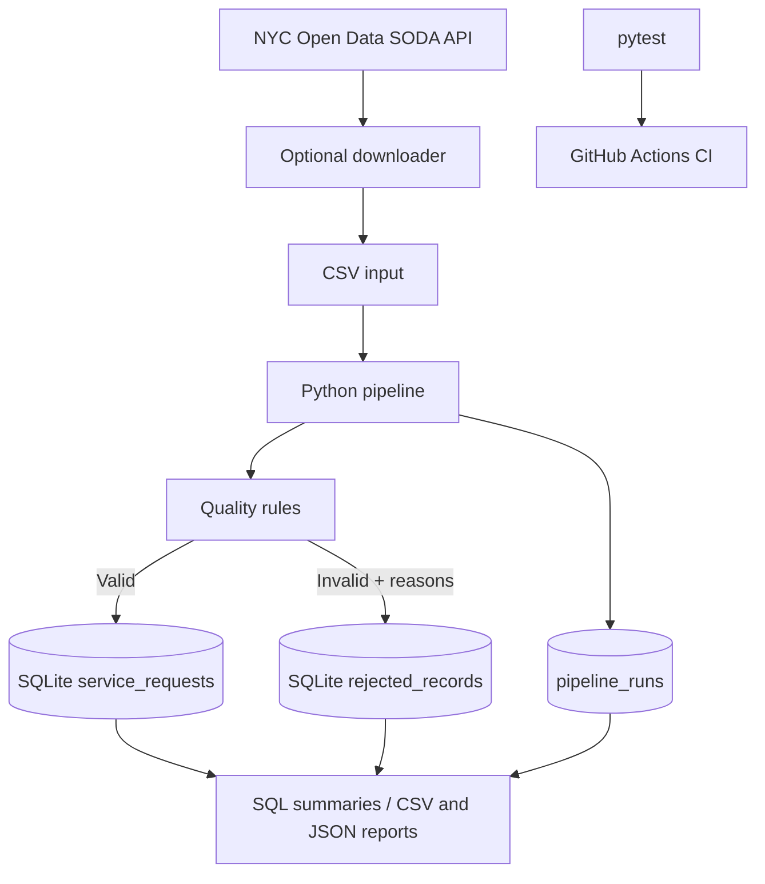

# 8. Architecture and Design Decisions

## Responsibilities
- `download_nyc311.py`: fetches a limited recent sample from NYC Open Data.
- `quality.py`: validates required columns, values, request key uniqueness, and date consistency.
- `database.py`: defines SQLite tables, upserts accepted records, saves rejected rows, and records run history.
- `pipeline.py`: orchestrates the ETL, logs activity, handles errors, and records run metrics.
- `reporting.py`: produces a JSON run report and CSV summaries.
- `tests/`: tests quality rules and end-to-end behavior.
- `.github/workflows/ci.yml`: runs tests on proposed code changes.

## Design choices
- SQLite makes the project approachable without database-server administration.
- The sample dataset makes tests deterministic and offline.
- The optional live downloader keeps the project tied to current public NYC 311 data.
- Rejected rows are retained with explicit reasons.
- Accepted rows use `unique_key` as a primary key.
- The local database and raw downloads are not committed to Git.
